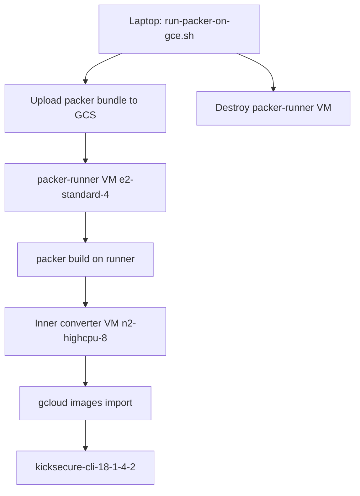

# Kicksecure custom image for GCP (remote Packer pipeline)

Import [Kicksecure KVM CLI](https://www.kicksecure.com/wiki/KVM) as a GCP image **without local Packer or a large local download**. A orchestrator script uploads the Packer bundle, starts a **packer-runner VM** on GCP, and that VM runs `packer build` (which creates a second inner converter VM for download/convert/import).

## Quick start (from laptop — no local Packer)

```bash
cp UnusedOS/packer/kicksecure-gcp/variables.auto.pkrvars.hcl.example \
   UnusedOS/packer/kicksecure-gcp/variables.auto.pkrvars.hcl

bash UnusedOS/scripts/kicksecure/run-packer-on-gce.sh
```

## Architecture



| Component | Path |
|-----------|------|
| Packer templates | `packer/kicksecure-gcp/` |
| Runner Terraform | `terraform-packer-runner/` |
| Orchestrator | `scripts/kicksecure/run-packer-on-gce.sh` |
| UnusedOS on Kicksecure | `terraform-test-kicksecure/` |

## After import

```bash
bash UnusedOS/scripts/run_kicksecure_vm_build_deploy_test.sh
```

## Manual steps on runner (debug only)

If the runner VM is kept (`--keep`):

```bash
gcloud compute ssh packer-kicksecure-runner-0 --zone=us-central1-a --user=admin --tunnel-through-iap
sudo tail -f /var/log/packer-runner.log
```

## Re-import

1. `gcloud compute images delete kicksecure-cli-18-1-4-2 --project=PROJECT`
2. Re-run `run-packer-on-gce.sh`

## Legacy local scripts

`download-kvm-image.sh`, `prepare-disk-for-gcp.sh`, and `import-to-gcp.sh` remain for fully manual offline conversion.
